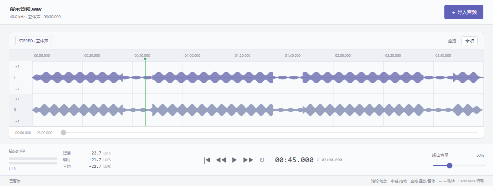
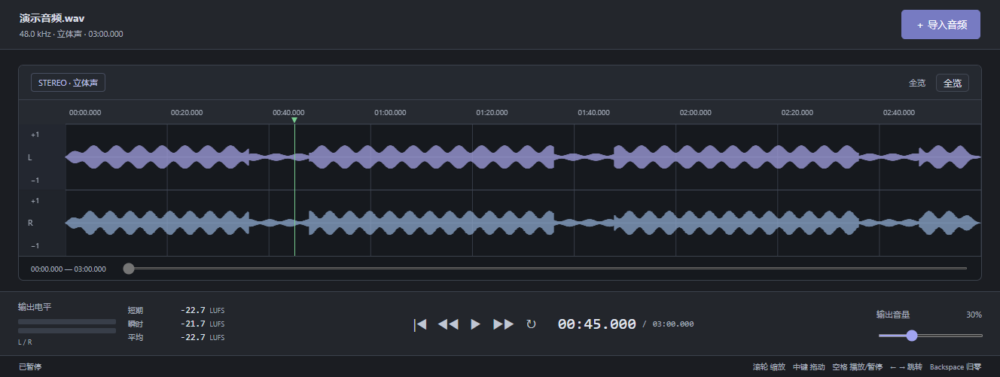

# LIFE LINE WaveDeck

一个面向 Windows 的轻量本地音频播放器，用清晰的波形和简洁的走带控制试听音频，并查看不受输出音量影响的源音频响度。

**Windows 10 / 11 · x64 · 当前版本 1.0.9**

[下载 Windows 免安装版](https://github.com/YPDDW1908/LIFE-LINE-WaveDeck/releases/latest)

## 界面

### 浅色模式



### 深色模式



截图来自实际界面，载入本地生成的演示音频。演示音频不内置于软件；启动时波形为空。界面会随 Windows 浅色／深色应用主题实时切换，无需重启。

## 功能

- 通过导入按钮或拖放打开音频；核心格式 MP3、FLAC、WAV。
- 单声道显示一条真实波形；立体声独立显示 L / R。
- 播放／暂停、归零、前后跳转 5 秒、全曲循环。
- 鼠标滚轮以指向的时间位置为中心缩放；按住中键左右平移波形。
- “全览”恢复完整波形；下方滚动条也可平移视图。
- 显示播放位置、总时长、输出电平和输出音量；默认音量 30%。
- 显示短期、瞬时及平均响度数值，单位 LUFS。
- 所有音频在本机处理，无录音、剪辑、效果器或云端上传功能。

## 使用

1. 从 [Releases](https://github.com/YPDDW1908/LIFE-LINE-WaveDeck/releases) 下载 Windows x64 ZIP。
2. **完整解压**，运行文件夹中的 `LIFE LINE WaveDeck.exe`。程序依赖同目录资源，不要只复制 EXE。
3. 点击“导入音频”或从资源管理器拖入音频文件。

使用免安装版无需另行安装 Node.js 或 Python。

| 操作 | 功能 |
|---|---|
| 空格 | 播放／暂停 |
| ← / → | 后退／前进 5 秒 |
| Backspace | 归零，保留原来的播放／暂停状态 |
| L | 切换循环 |
| 波形上左键点击 | 定位播放位置 |
| 波形上滚轮向上／向下 | 放大／缩小，范围 1–64 倍 |
| 按住鼠标中键左右拖动 | 放大后平移视图，不改变播放位置 |
| 全览 | 恢复完整波形 |

## 响度数值

响度测量分支位于输出音量调节之前，调小音量甚至静音都不会改变 LUFS 读数。

| 数值 | 测量方式 |
|---|---|
| 短期 | 最近 3 秒 |
| 瞬时 | 最近 400 毫秒 |
| 平均 | 本次播放累计的综合响度，使用 K 加权及绝对／相对双门限 |

暂停保留累计值；归零、定位或导入新文件会重置。短期／瞬时达到对应时间窗口之前显示 `—`，静音显示 `−∞`。综合响度每秒更新，并在暂停或播放结束时结算。当前响度计算支持单声道和立体声，多声道暂显示 `—`。

计算参考 [ITU-R BS.1770](https://www.itu.int/rec/R-REC-BS.1770) 和 [EBU 响度定义](https://tech.ebu.ch/loudness/)，已验证参考滤波系数、单／立体声参考信号及门限行为，尚未完成完整 EBU 测试集认证。

## 已知限制

- 音频完整解码到内存，单文件上限 512 MB；MP3 导入可能短暂等待，长音频需要更多内存。
- 采样率显示的是解码／播放采样率，可能与原文件不同。
- 普通资源管理器向管理员权限窗口拖放可能受 Windows 权限隔离限制；建议普通方式运行。
- 部分无效文件拖放在用户实测中未显示错误提示，原界面没有变化；此行为尚未改进。
- 免安装程序未做应用代码签名。

## 源码与构建

应用使用 Electron 44.7.0、Web Audio、Canvas 和 AudioWorklet，无额外第三方 JavaScript 应用依赖。渲染进程保持 `nodeIntegration=false`、`contextIsolation=true`、`sandbox=true`。

```text
main.cjs                桌面窗口、本地协议、系统主题
src/app.js              导入、真实波形、播放和视图控制
src/audio-core.js       音频峰值与时间等工具
src/drop-import.js      文件拖放
src/loudness-core.js    K 加权与综合响度计算
src/loudness-worklet.js 音频线程响度处理
tests/                  核心回归测试
build_windows.py        Windows x64 免安装包构建
```

使用 Python 3 构建，脚本下载固定官方 Electron 运行时并检查 SHA-256：

```sh
python build_windows.py
```

也可使用已下载的官方 ZIP 离线构建：

```sh
python build_windows.py /path/to/electron-v44.7.0-win32-x64.zip
```

使用 Node.js 运行现有回归测试：

```sh
node tests/drop-import.test.cjs
node tests/loudness.test.cjs
```

Windows 用户已实测核心音频格式、走带控制、拖放、滚轮缩放、中键平移及界面主题。本仓库不包含用户音乐、私人文件或开发过程的聊天记录。
